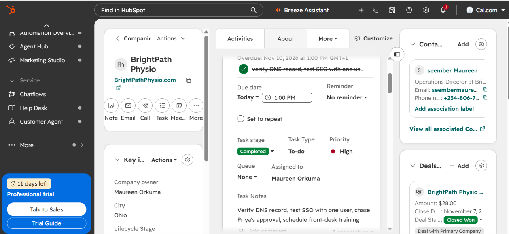
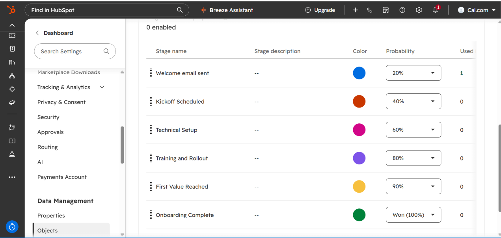
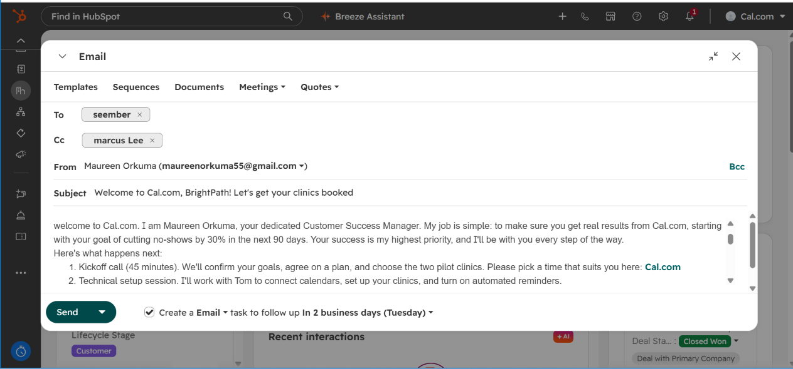
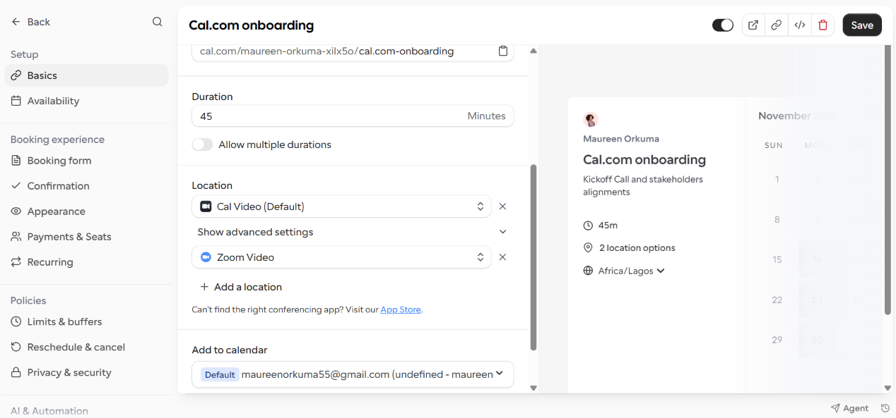
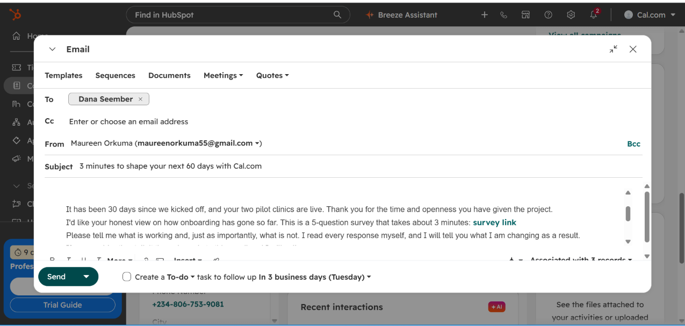

# Scenario 1: Onboarding BrightPath Physio on Cal.com

<aside>
⚠️

Self-initiated customer success simulation. BrightPath Physio and all people named are fictional. Not affiliated with or endorsed by [Cal.com](http://Cal.com). Outcomes marked "Simulated" are illustrative.

</aside>

## 1. Situation

BrightPath Physio is a physiotherapy group with 6 clinics and 45 staff (38 practitioners, 7 front-desk and admin). They bought [Cal.com](http://Cal.com) on the Organizations plan, 45 seats, annual, to cut no-shows and reduce the front desk's phone scheduling.

|  |  |
| --- | --- |
| **Customer goal** | Reduce no-shows from 18% to 12.6% (a 30% reduction) within 90 days |
| **Secondary goal** | Cut front-desk scheduling calls from about 250 to 120 per week |
| **Executive sponsor** | Dana Seember, Operations Director |
| **Champion** | Marcus Lee, Head of Front Desk |
| **Skeptic** | Priya Raman, Lead Physiotherapist (worried about patient experience) |
| **IT owner** | Tom Becker, IT Manager |
| **My role** | Customer Success Manager, with a technical account management focus |

## 2. My approach

1. Set up the account in HubSpot so every step is recorded.
2. Welcome the customer and book the kickoff.
3. Write a success plan with measurable targets and a 30/60/90 timeline.
4. Run a kickoff to align the sponsor, champion, clinicians and IT.
5. Run a technical setup session with IT, and test before go-live.
6. Train the front desk with hands-on practice.
7. Spot expansion signals and hand them off without pushing too early.

## 3. Step by step

### Step 1: Account set up in HubSpot

**What I did:** created the BrightPath company record with custom properties (Plan, Seats, Renewal date, Onboarding stage, Health status, Clinics live, Expansion potential), four contacts, a deal, an onboarding pipeline and a task list.

**Why it matters:** a real CSM keeps the account record complete from day one so anyone on the team can see where the customer stands.

***HubSpot company record with custom properties***

***Onboarding pipeline and task list***

### Step 2: Welcome email

**What I did:** sent a warm welcome email that introduced me as the dedicated CSM, restated the 90-day goal, explained the next three steps (kickoff, technical setup, training) and listed what to prepare. The kickoff booking link was a real [Cal.com](http://Cal.com) event type.

**Why it matters:** the first message sets expectations and tone. It shows the customer exactly what happens next.

***Sent welcome email on the HubSpot timeline***

***kickoff event type or booking page***

### Step 3: Success plan

**What I did:** wrote a success plan with the customer's goals, six success metrics with day 30, 60 and 90 targets, a stakeholder map, a 30/60/90 timeline, a risk table with mitigations, a communication plan and a responsibilities table.

**Why it matters:** the success plan is the document that keeps everyone accountable to the same goal.

**Document:** [Customer Success Plan: BrightPath Physio] [Customer Success Plan](file:///C:/Users/USER/Downloads/Customer%20Success%20Plan%20BrightPath%20Physio%20(2).pdf)

***Success plan, metrics table page***

### Step 4: Kickoff call

**What I did:** built a 7-slide kickoff deck, prepared a 45-minute run sheet and discovery questions, and rehearsed the call with a practice role-player using a written briefing. I sent a recap email within hours with owners and dates.

**Why it matters:** the kickoff turns a signed contract into a shared plan.

**Documents:** 

[BrightPath Physio Kickoff.pdf](BrightPath_Physio_Kickoff.pdf)

***Kickoff recap email***

### Step 4b: Dedicated Slack channel

**What I did:** created a Slack channel for the account, pinned the success plan and the kickoff booking link, and posted short updates as the work progressed.

 ***Slack channel with pinned success plan and first post***

### Step 5: Technical setup session with IT

**What I did:** sent Tom a checklist two days ahead (calendar type, SSO, DNS access, clinic and staff lists, security approvals). In the session I connected pilot calendars, set up sub-teams per clinic, created appointment types, turned on reminders and ran a test booking from start to finish. SSO and the custom domain were given named owners and due dates, with a fallback so the pilot would not slip.

**Why it matters:** this is the technical account management part of the role. I test before go-live, translate between IT and business stakeholders, and close each item with an owner and a date.

***Reminder Workflow set up***

### Step 6: Front-desk training

**What I did:** wrote a one-page quick guide for the desk, a 60-minute training agenda with hands-on practice, three real-life practice scenarios and a three-question feedback form.

**Why it matters:** adoption is won or lost at the front desk. People learn by doing, and the quick guide stays at their desks afterwards.

 ***Quick guide***

***Training agenda***

### Step 6b: Day-30 onboarding feedback

**What I did:** at day 30 I asked the customer how onboarding was going, with a 5-question survey (satisfaction, clarity, likelihood to recommend, what was hardest and what to improve) and a personal email to the sponsor and team. I logged the scores in HubSpot, followed up with anyone who scored low within two business days, and sent a "You said, we did" email showing what I changed. I also sent recurring themes to the product team.

**Why it matters:** voice of the customer is a core CSM duty. Problems found at day 30 can be fixed. The same problems found at renewal are a churn risk.

| Person | What they told me (simulated) | What I did |
| --- | --- | --- |
| Priya, clinical lead | Worried reminders would feel impersonal | Demoed the reminder editor, and she approved the final wording |
| Tom, IT | SSO instructions were hard to follow | Wrote a step-by-step SSO guide with a checklist |
| Marcus, front desk | Training felt long | Shortened and split the next session |

**Simulated scores:** satisfaction average [4.0] out of 5, clarity [4.0] out of 5. With four respondents I treat the likelihood-to-recommend score as a signal, not a statistic.

**Document:** 

 ***Survey questions***

***Survey email on the HubSpot timeline***

***Low-score follow-up task***

 ***"You said we did" email***

### Step 7: Expansion opportunity

**What I did:** during training, staff mentioned a seventh clinic opening soon. I acknowledged it, asked one open question and did not discuss price. I created an expansion deal in HubSpot, set the company property to "Expansion potential: Identified", and sent the account executive a written handoff note, asking them to wait until the pilot showed results before any proposal.

**Why it matters:** expansion works best when it follows value the customer has already seen. I protect the relationship first.

***HubSpot expansion deal***

***Handoff note to the account executive***

### Step 7a: Day-90 business review (QBR)

**What I did:** prepared and ran a business review with the sponsor to show the results against the 90-day goal, agree next quarter's targets and open the conversation about the Eastgate clinic. I pulled the numbers from my adoption tracker, built a short deck and a one-page executive summary, sent a pre-read three days ahead, and followed up with a recap and actions.

**Why it matters:** a business review proves value to the person who signs the contract, supports the renewal, and creates the right moment for expansion, after the customer has seen results.

| Measure | Goal | Simulated day-90 result |
| --- | --- | --- |
| No-show rate | 12.6% (30% reduction) | [13.1%] (27% reduction), close but not yet at goal |
| Online booking share | 70% | [70%] |
| Staff with calendar connected | 95% | [91%], Eastside still behind |
| Reminders active | All clinics | All six clinics |

**What I told the customer honestly:** we are close to the goal but not there. The gap is mainly Eastside's slower adoption, so the next-quarter plan includes a clinic-lead 1:1, a drop-in session and a refresher on reminders.

**Next-quarter goals agreed:** no-show rate at or below 12.6%, 95% adoption, and a ready-to-go setup plan for Eastgate.

***The sent invite or recap email on Dana's timeline***

 ***results slide***

[https://docs.google.com/presentation/d/1Vvmnd8kkV4_9hSdvIdQB7YW9aKOQqgG2mHaooSNrbwg/edit?slide=id.p1#slide=id.p1](https://docs.google.com/presentation/d/1Vvmnd8kkV4_9hSdvIdQB7YW9aKOQqgG2mHaooSNrbwg/edit?slide=id.p1#slide=id.p1)

***Health Score***

***One-page executive summary***

**Goal:** reduce no-shows from 18% to 12.6% (a 30% reduction) within 90 days.

| Measure | Goal | Result |
| --- | --- | --- |
| No-show rate | 12.6% | 13.1% (27% reduction) |
| Online booking share | 70% | 70% |
| Staff with calendar connected | 95% | 91% |
| Reminders active | All clinics | All six clinics |
| Front-desk scheduling calls per week | 120 | about 135 |

***QBR follow-up email with agreed actions***

## 8. Results (simulated)

| Measure | Target | Simulated result |
| --- | --- | --- |
| Training confidence (1 to 5) | 4 or higher | [4.2] |
| Pilot clinics ready for go-live | 2 of 2 | [2 of 2] |
| Test booking and reminders | Pass | [Pass] |
| Expansion identified | Yes | Seventh clinic, about [8] extra seats |
| No-show rate trajectory | 18% to 12.6% in 90 days | [adoption sheet](https://docs.google.com/spreadsheets/d/1HR7VArh5LIhDJZy2EWAbcczKs81a2624OYWMfY66LGI/edit?usp=sharing) |

***Adoption tracking sheet and no-show chart***

[**Adoption by Clinic (week 8)**](https://docs.google.com/spreadsheets/d/1HR7VArh5LIhDJZy2EWAbcczKs81a2624OYWMfY66LGI/edit?gid=1759386087#gid=1759386087)

## 9. What I would do differently

- Involve clinicians before the kickoff so concerns about patient experience are heard earlier.
- Ask about IT access and approvals at kickoff, so the setup session can start sooner.
- Ask about future clinics and hiring plans at kickoff, so expansion is on the plan from the start.
- Share a mid-point progress summary with the sponsor at day 45, so the day-90 review holds no surprises.

## 10. Skills this scenario demonstrates

| Customer Success | Technical Account Management |
| --- | --- |
| Success planning with measurable targets | Technical onboarding and testing |
| Stakeholder management | SSO and custom domain ownership |
| Training and adoption | Troubleshooting guide and escalation route |
| CRM discipline in HubSpot | Translating between business and IT |
| Expansion identification and handoff | Product feedback from customer confusion |

##