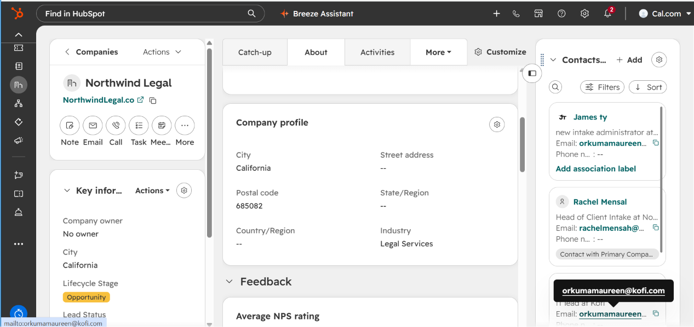
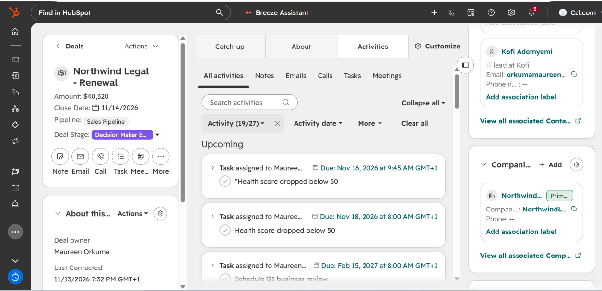
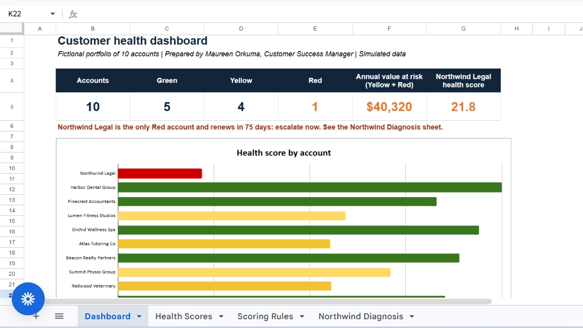
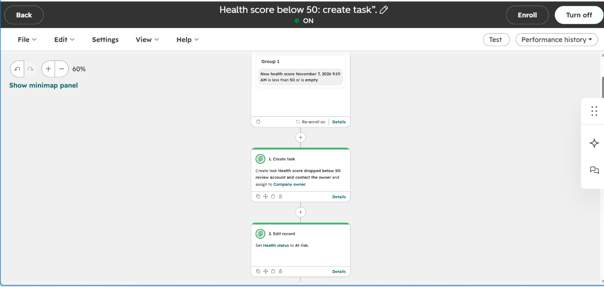
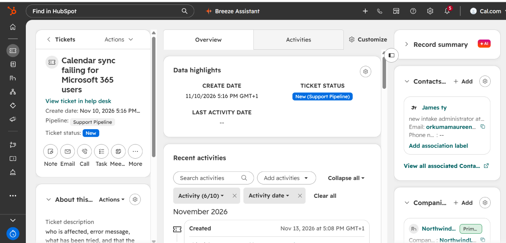
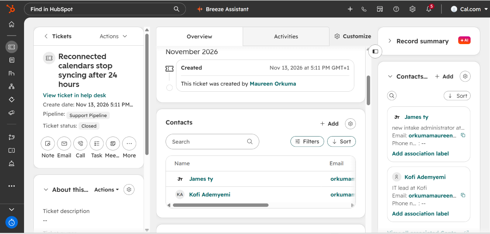
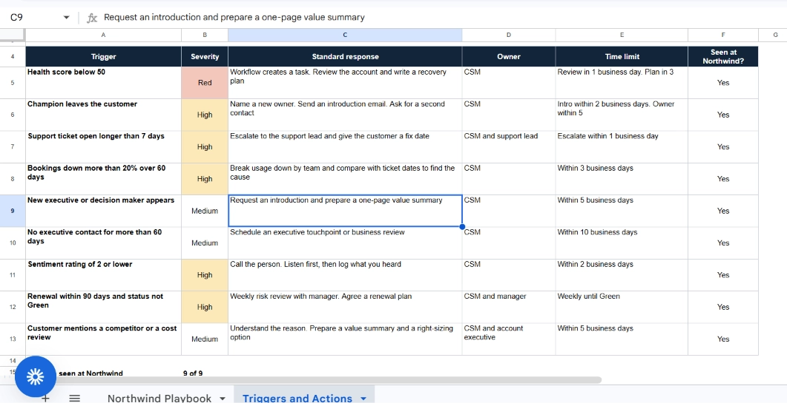
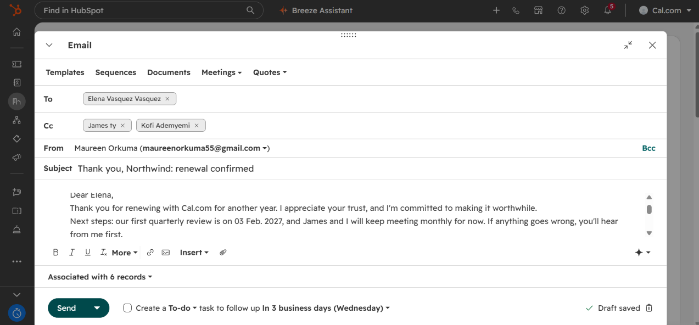

# Scenario 2: Northwind Legal, At-Risk Renewal Save

<aside>
⚠️

Self-initiated customer success simulation. Northwind Legal and all people named are fictional. Not affiliated with or endorsed by [Cal.com](http://Cal.com). Outcomes marked "Simulated" are illustrative.

</aside>

## 1. Situation

Northwind Legal is a mid-sized law firm with five practice groups and 120 [Cal.com](http://Cal.com) seats on the Organizations plan. The account renews in 75 days, and it is slipping.

|  |  |
| --- | --- |
| **Health score** | 21.8 out of 100 (Red) |
| **Usage** | Bookings down 40% over the last 60 days |
| **Champion** | Rachel Mensah, Head of Client Intake, left three weeks ago |
| **Open issues** | Two calendar sync tickets, the oldest 23 days old |
| **New stakeholder** | Elena Vasquez, Managing Partner, has started a software cost review |
| **Other contacts** | James Whitfield (Office Administrator, new to the tool), Kofi Adeyemi (IT Lead) |
| **My role** | Customer Success Manager, with a technical account management focus |
| **My goal** | Renew the account by finding the real cause, fixing it and proving value, not by discounting |

## 2. My approach

1. Score the account against a health model so the risk is clear and measurable.
2. Diagnose the causes with a set of hypotheses to test, not assumptions.
3. Fix the technical problem first, with the customer's IT lead.
4. Build a new day-to-day owner and reach the executive decision maker.
5. Show results, then propose the renewal.
6. Put an early-warning workflow in place so it does not happen again.

## 3. Step by step

### Step 1: Account set up in HubSpot

**What I did:** created the Northwind company record with custom properties (Health score, Health status, Risk reason, Renewal date), four contacts (including the former champion, marked as former), a renewal deal with the close date, and tasks for each stakeholder.

**Why it matters:** a clean record shows the whole team what is at stake and who owns what.

***Northwind company record with custom properties***

 ***Contacts and the renewal deal***

***Task list***

### Step 2: Customer health score model

**What I did:** built a spreadsheet model that scores accounts on product usage, seat adoption, support health, engagement (including champion status) and sentiment. Every weight and threshold is an editable input. I applied it to ten fictional accounts, and Northwind is the only Red one (5 Green, 4 Yellow, 1 Red). Accounts that are Red and within 90 days of renewal are flagged "Escalate now".

**Why it matters:** a health score turns "I have a bad feeling about this account" into evidence, and tells the team where to spend time.

  ******

***Health Scores table with Northwind highlighted in red***

***Scoring Rules sheet (weights and thresholds) [link](https://docs.google.com/spreadsheets/d/1bW5FItjeEp5XvfXh1ffmKmL0qEW7exVp9CNqvfnYSkU/edit?usp=sharing)***

### Step 3: Diagnosis

**What I did:** listed six warning signs with a likely cause, a way to test each, an owner and a due date. For example, the 40% drop in bookings could mean the sync problem blocked staff, or that the departure of the champion let adoption drift. I planned discovery calls to find out which.

**Why it matters:** treating causes as hypotheses stops you offering a discount to fix a problem that is really technical.

***Northwind Diagnosis sheet***

### Step 4: Early-warning workflow

**What I did:** built a HubSpot workflow that triggers when a company's health score drops below 50. It creates a task for the account owner and sets health status to Red. I tested it on a sample record.

**Why it matters:** the best save is the one you see coming. This catches the next Northwind before it reaches 75 days from renewal.

***Workflow setup (trigger and actions)***

***Task created by the workflow***

### Step 5: Technical fix with IT

**What I did:** logged the two sync issues as HubSpot tickets with priority and customer impact, escalated them to the support lead with a fix date request, and held a call with Kofi. In the simulation, the cause was a security policy change that now required admin approval for calendar access. Kofi granted consent, staff reconnected, and we ran a test booking together. Both tickets were closed with resolution notes, and I added a quarterly technical check to the account plan.

**Why it matters:** this is the technical account management part of the role. I found the cause with the customer's IT team and proved the fix before talking about renewal.

 ***The two HubSpot tickets (one open, one closed)***

***Escalation email to the support lead***

 ***Email to Kofi on the HubSpot timeline***

### Step 6: Re-engage stakeholders

**What I did:** followed a risk playbook that set the order, the message and the deadline for each contact. I welcomed James as the new day-to-day owner and offered training and a quick guide. I wrote to Elena openly: bookings had dipped, there was an unresolved sync problem, and I wanted to earn the renewal with results, not a sales call.

**Why it matters:** the champion had left and the new executive did not know the product. Reaching both was the real risk work.

 ******

***Email to James on the timeline***

***Email to Elena on the timeline***

***Risk playbook table [LINK](https://docs.google.com/spreadsheets/d/1L-OBhzXAbxvu2xUR1wRjaVgvcl-VwvmSM5-mrNhShPg/edit?usp=sharing)***

### Step 7: Renewal proposal and outcome

**What I did:** after the fix and a month of recovery, I sent Elena a short proposal: renew all 120 seats for 12 months, with quarterly business reviews, a named point of contact and a technical check each quarter. She agreed, I moved the deal to Closed won, and I updated the health score and status.

**Why it matters:** the renewal came from results and a plan, not from a discount.

***Renewal proposal email***

***Deal marked Closed won***

## 4. Results (simulated)

| Measure | Before | After (30 days) |
| --- | --- | --- |
| Health score | 21.8 (Red) | 72.3 (Yellow, improving) |
| Bookings change, last 60 days | -40% | -12% and rising |
| Oldest open ticket | 23 days | None |
| Champion | Left | James named as owner |
| Renewal | At risk | Renewed, 120 seats, 12 months |

## 5. What I would do differently

- Treat a champion leaving as a risk signal on the day it happens, not three weeks later.
- Keep at least two engaged contacts at every account, so one departure does not leave a gap.
- Escalate slow support tickets automatically, so no ticket gets to 23 days.
- Hold a mid-year review with new executives early, before they start a cost review.

## 6. Skills this scenario demonstrates

| Customer Success | Technical Account Management |
| --- | --- |
| Health scoring and risk detection | Investigating a sync failure with the customer's IT lead |
| Stakeholder re-engagement | Ticket management and internal escalation |
| Executive communication | Test plan to prove the fix |
| Renewal strategy without discounting | Quarterly technical health check |
| Workflow automation in HubSpot | Feeding recurring issues to support and product |