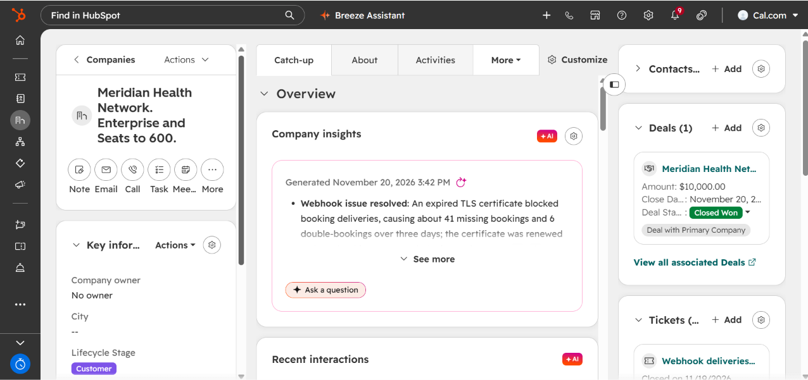
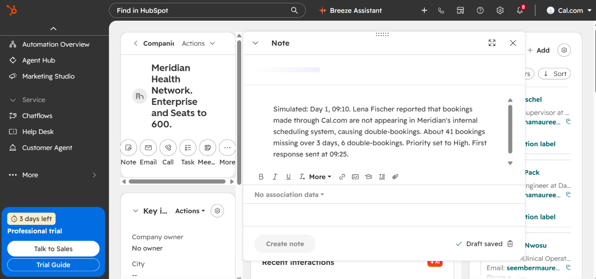
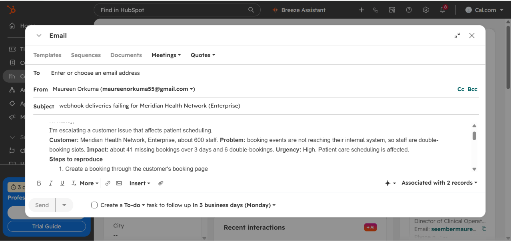
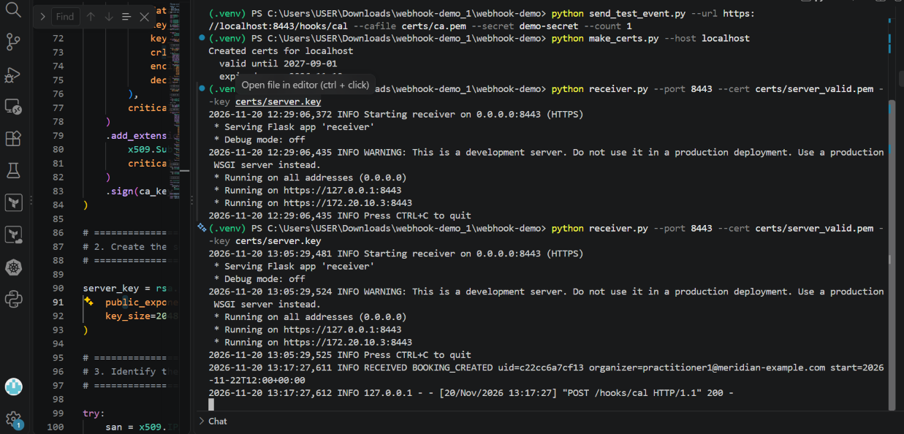
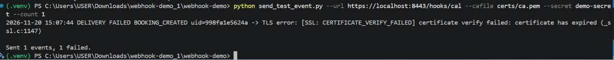
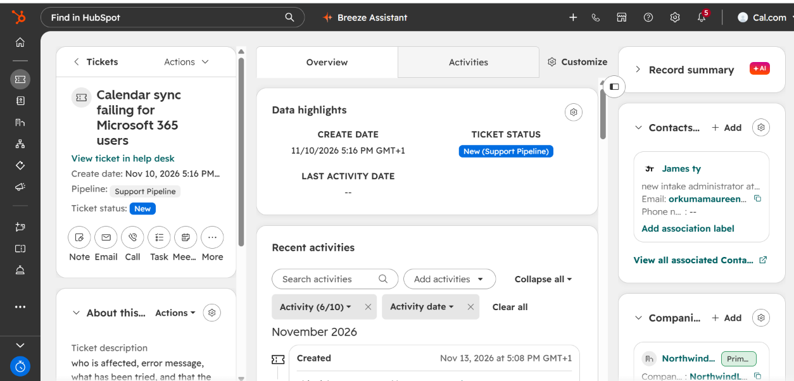
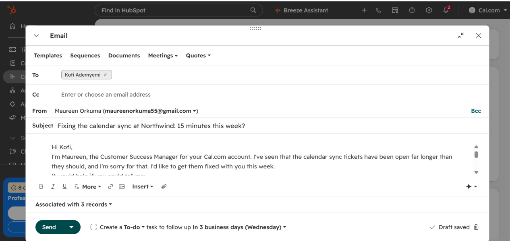
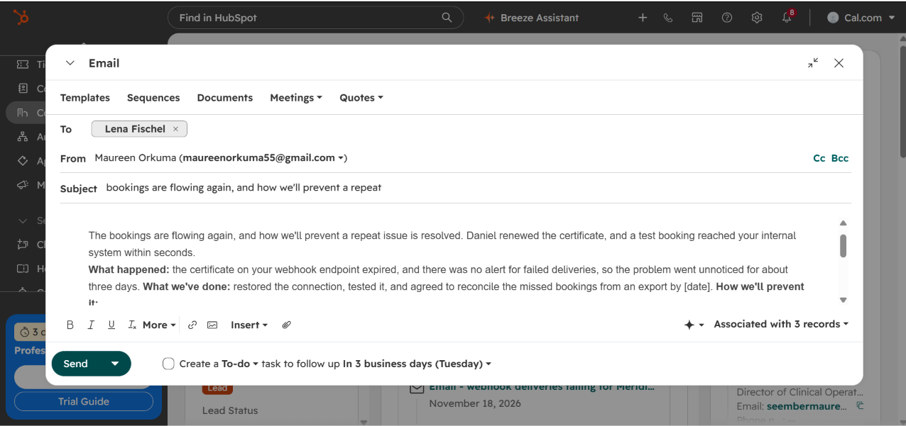
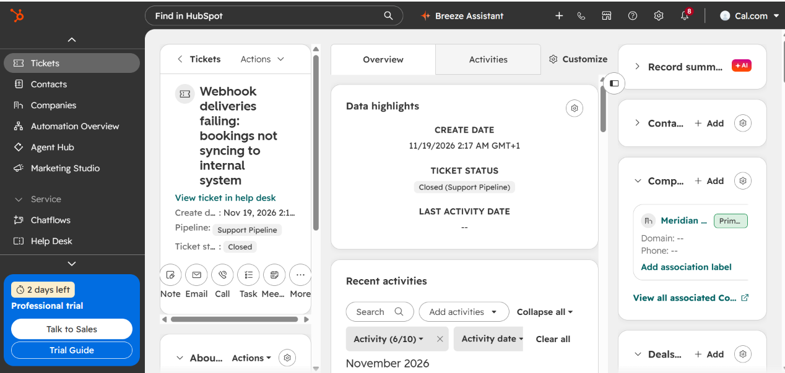
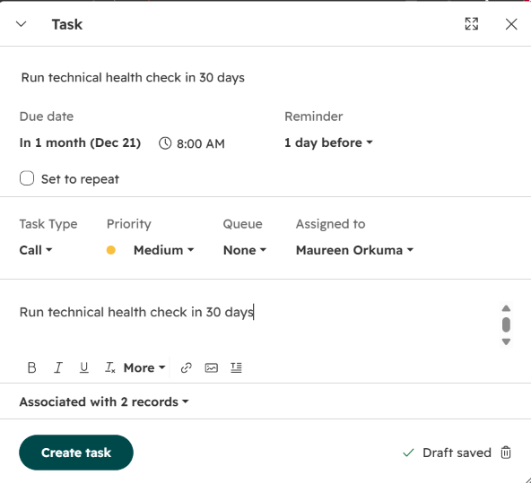

# Scenario 3: Meridian Health Network, Technical Escalation

<aside>
⚠️

Self-initiated customer success and technical account management simulation. Meridian Health Network and all people named are fictional. Not affiliated with or endorsed by [Cal.com](http://Cal.com). Outcomes marked "Simulated" are illustrative.

</aside>

## Project status at a glance

| Item | Status |
| --- | --- |
| Core incident simulation: healthy delivery, expired certificate, failure reproduced | Completed (local test environment) |
| Root cause identified: expired TLS certificate, plus an old receiver process still serving it | Completed |
| Customer-facing incident update | Prepared |
| HubSpot ticket, notes and emails | Prepared in a copy-ready pack. Mark as completed once logged, with screenshots |
| Service restoration and successful delivery after the fix |  Verified |
| Missed-booking reconciliation | Verified |
| Post-incident review | Completed |
| Prevention: certificate expiry monitoring, delivery alerts, health checks | Deployed |
| GitHub repository, architecture diagram, screenshots | Completed and attached |

**Environment:** local development and testing on Windows, using Python, Flask, HTTPS/TLS certificates (Python cryptography library), SQLite, PowerShell and VS Code. Not deployed to AWS or any production system. The customer, the people and the impact figures are fictional.

## 1. Situation

Meridian Health Network is a regional healthcare group with 14 clinics and about 600 staff on [Cal.com](http://Cal.com) Enterprise. [Cal.com](http://Cal.com) sends booking events by webhook to Meridian's internal scheduling system. One Monday morning the scheduling supervisor reported that bookings had stopped appearing in the internal system, and staff were double-booking slots.

|  |  |
| --- | --- |
| **Problem** | Booking confirmations not syncing to the internal scheduling system |
| **Impact** | Scenario assumption (fictional, not a measured result): about 41 bookings missing over 3 days and 6 double-booked slots |
| **Sponsor** | Amara Nwosu, Director of Clinical Operations |
| **Technical owner** | Daniel Park, Integration Engineer |
| **Day-to-day contact** | Lena Fischer, Scheduling Supervisor |
| **Integration** | Webhooks for booking created, rescheduled and cancelled events |
| **Urgency** | High: patient care scheduling is affected |
| **My role** | Customer Success Manager with a technical account management focus |

## 2. My approach

1. Acknowledge fast, with an owner, a next step and a time for the next update.
2. Capture the issue in a HubSpot ticket with priority, impact and a service target.
3. Reproduce the problem myself, so I escalate evidence, not guesses.
4. Escalate to engineering with clear reproduction steps, logs, impact and urgency.
5. Update the customer at every stage in plain language.
6. Fix it with the customer's integration engineer, then recover the missed bookings.
7. Write a post-incident review and prevent a repeat with monitoring and a technical health check.

## 3. Step by step

### Step 1: Account set up and ticket in HubSpot

**What I did:** set up the Meridian company record with three contacts and a High-priority ticket describing the problem, impact, integration and urgency, with a service target of one hour for the first response, updates every four hours and a 24-hour resolution target. The notes and first customer response are drafted in the HubSpot pack. *Status: prepared. Mark as completed once logged in HubSpot with screenshots.*

**Why it matters:** a clear ticket means nothing is lost in handover, and the service target tells everyone what "good" looks like.

 ***Meridian company record***

 ***Ticket with priority, description and properties (status New)***

 ***First response email on the timeline***

### Step 2: Reproducing the problem

**What I did:** built a working webhook demonstration in a local environment using Python and Flask: a receiver listening on HTTPS (port 8443), a sender that plays the booking platform and signs its events, and a script that generates a demo certificate authority, a valid certificate and an expired one. I first proved healthy delivery (HTTP 200), then switched the receiver to the expired certificate and reproduced the failure. The sender rejected the connection with "certificate verify failed: certificate has expired" before the request ever reached the application.

**Why it matters:** reproducing the issue turns "customer says it's broken" into evidence engineering can act on, and it proves I understand how the integration works.

[***GITHUB LINK](https://github.com/Engr-Maureen-Cloud/webhook-tls-incident-simulation)  webhook receiver code and README***

 ***Receiver working, with the booking event arriving***

 ***Receiver failing after the certificate expires (log line)***

 

***Architecture diagram***

### Step 2b: Technical investigation

**What I did:** inspected the certificate authority and server certificates (subject, issuer, validity dates and extensions), compared the live certificate fingerprint with the certificate saved on disk, and used PowerShell to find the Python processes listening on port 8443. I found that an older receiver process was still running with the expired certificate, which is why the live endpoint kept presenting it even after another receiver was started with the valid certificate.

**Why it matters:** it is a reminder to check what is actually running and what the live endpoint presents, not only the configuration or the startup command.

***Certificate inspection (validity dates)***

***Processes listening on port 8443 and the old receiver's command line***

### Step 3: Escalation to engineering

**What I did:** wrote an escalation email with the customer and plan, the problem and impact, numbered steps to reproduce, what I had already checked, my hypothesis (an expired certificate on the customer's endpoint) and a specific ask. I set the ticket to Waiting on us, ticked the escalation property and logged a note.

**Why it matters:** a good escalation saves engineers a day. It shows evidence, impact and urgency without drama.

***Escalation email***

 ***Ticket at Waiting on us with the escalation note***

Step 4: Customer communication

**What I did:** prepared three plain-language updates: an acknowledgment with a time for the next update, a root cause message that explained what happened and what Daniel needed to do, and a resolution message that covered the cause, the fix and the prevention plan. The resolution message is a template, to send only once recovery is verified.

**Why it matters:** during an incident, silence does more damage than the fault. Clear updates keep trust.

 ***Root cause update email***

***Resolution email***

### Step 5: Fix and recovery

**What I did:** *Status: not yet verified.* I identified the recovery path: replace the expired certificate, stop the old receiver process, restart the receiver with the valid certificate, verify the live certificate, test a webhook delivery, then reconcile any missed bookings. In the demo, an old receiver process kept serving the expired certificate, so a successful delivery after the fix has not yet been confirmed. I will mark this step complete only after a successful delivery and a reconciliation.

**Why it matters:** fixing the fault is half the job. The missed bookings still have to be recovered, or the double-bookings continue.

***Receiver working again after the fix***

***Ticket at Closed with the root cause***

### Step 6: Post-incident review

**What I did:** *Status: in progress.* I am writing a blameless review with the timeline, root cause, why the failure was silent, what went well, what to change, and a list of actions with owners and dates. It will state clearly that final recovery is not yet verified.

**Why it matters:** the review is how a team learns, and it shows the customer you take the incident seriously.

post-incident review document: [document Link](https://docs.google.com/document/d/1IECMk-RcNsjlZA5OFZ34HqL9RLsflj1I8E6k5spXB80/edit?usp=sharing)

***Post-incident review, first page***

### Step 7: Prevention and technical health check

**What I did:** recommended a quarterly technical health check for enterprise accounts: certificate expiry dates, webhook delivery success, failed delivery alerts, permissions and a review of integration runbooks. These are recommendations from the simulation, not controls I have deployed. Proposed follow-ups: run the health check in 30 days, review certificate monitoring with the customer's integration engineer, and suggest that failed webhook deliveries be visible to admins.

**Why it matters:** the best incident response includes making the next one less likely.

 ***Follow-up tasks on the company record***

## 4. Results

### Verified in the demo

| Measure | Result |
| --- | --- |
| Healthy baseline | Booking event delivered over HTTPS with HTTP 200, confirmed in the receiver logs |
| Failure reproduced | With the expired certificate, the sender reported "certificate verify failed: certificate has expired" and no request reached the application |
| Root cause | Expired TLS certificate (the valid certificate runs until September 1, 2027; the expired one expired on November 10, 2026) |
| Additional finding | An older receiver process kept serving the expired certificate on port 8443 |

### Recommended, not deployed

| Measure | Status |
| --- | --- |
| Certificate expiry monitoring and renewal reminders | Recommended |
| Alerts on failed webhook deliveries | Recommended |
| Regular integration health checks | Recommended |

## 5. What I would do differently

- Set up a webhook delivery-failure alert for enterprise customers at onboarding, so the first sign of trouble is not a double-booking.
- Add certificate expiry dates to the customer's technical profile in HubSpot, with a task 30 days before each one.
- Run the technical health check in the first 60 days of every enterprise account, not only after an incident.
- Before testing a fix, check for old processes still running, and confirm the live endpoint's certificate after every restart.

## 6. Skills this scenario demonstrates

| Customer Success | Technical Account Management |
| --- | --- |
| Clear, calm incident communication | Reproducing and diagnosing an integration failure |
| Setting and keeping service targets | Escalating to engineering with evidence |
| Explaining a technical failure in terms of customer impact | Inspecting certificates and running processes to find a root cause |
| Prevention planning and follow-up | Monitoring, alerts and health checks |
| CRM discipline in HubSpot tickets | Technical documentation and a post-incident review |

##